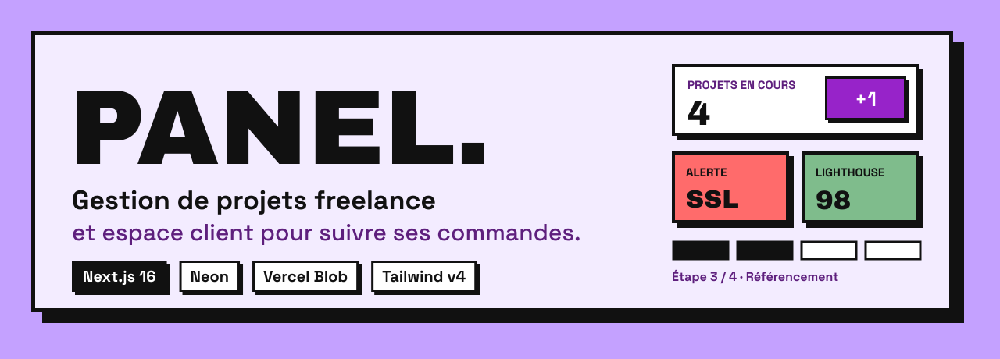
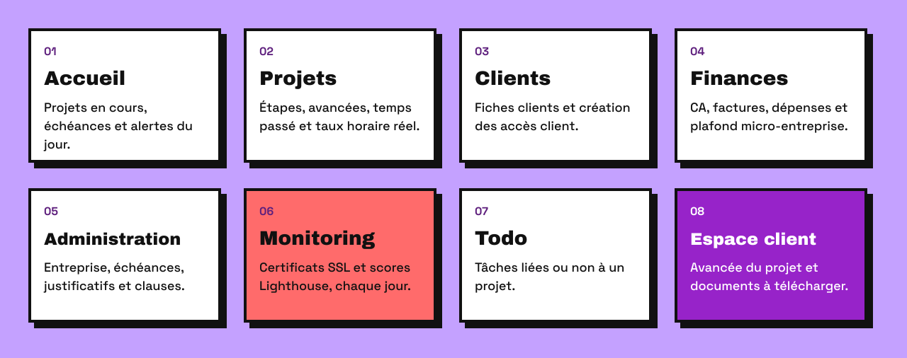
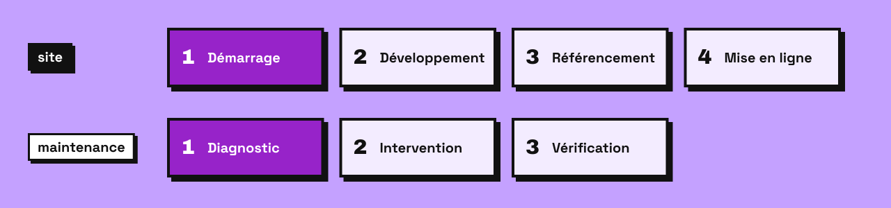

<div align="center">



<br>

     

**[panel.gaeltournier.dev](https://panel.gaeltournier.dev)** · [Dépôt GitHub](https://github.com/FlyingCow31/newportfolioclient)

</div>

---

Panel de gestion interne pour toute entreprise (plutôt axé micro-entreprise) de professions libérales, avec un espace client pour suivre l'avancée des projets. Style néo-brutaliste, lié à mon style graphique de prédilection.

> [!NOTE]
> **Compte de démonstration** · utilisateur : `Test` · mot de passe : `Test123@`

---

## Disclaimer : utilisation de l'IA

> [!IMPORTANT]
> Ce projet est avant tout un projet backend. La quasi-totalité du front-end a été réalisée avec l'IA, entraînée sur mes projets et sur mon style graphique.
> Le backend a été réalisé à 95 % à la main, à l'aide de la documentation, hormis la partie Todo (la gestion des states a été faite par IA ; dans tous les cas, ça se voit).

---

## Sommaire

|                                                                 |                                                      |                                        |
| --------------------------------------------------------------- | ---------------------------------------------------- | -------------------------------------- |
| **01** · [Fonctionnalités](#fonctionnalités)                    | **06** · [Base de données](#base-de-données)         | **11** · [Déploiement](#déploiement)   |
| **02** · [Stack](#stack)                                        | **07** · [Scripts](#scripts)                         | **12** · [Contribution](#contribution) |
| **03** · [Prérequis](#prérequis)                                | **08** · [Structure du projet](#structure-du-projet) | **13** · [Licence](#licence)           |
| **04** · [Installation](#installation)                          | **09** · [Routes API](#routes-api)                   |                                        |
| **05** · [Variables d'environnement](#variables-denvironnement) | **10** · [Rôles et accès](#rôles-et-accès)           |                                        |

---

## Fonctionnalités



### Panel admin

| Module             | Ce qu'il fait                                                                                     |
| ------------------ | ------------------------------------------------------------------------------------------------- |
| **Accueil**        | Vue d'ensemble des projets en cours, échéances et alertes                                         |
| **Projets**        | Étapes, avancées (modifiables sur place), temps passé rémunéré et non rémunéré, taux horaire réel |
| **Clients**        | Fiches clients modifiables, création des accès à l'espace client, documents partagés              |
| **Finances**       | Chiffre d'affaires, factures, dépenses, plafond micro-entreprise                                  |
| **Administration** | Informations de l'entreprise, échéances, justificatifs, bibliothèque de clauses                   |
| **Monitoring**     | Certificats SSL et scores Lighthouse des sites livrés, vérifiés automatiquement                   |
| **Todo**           | Tâches liées ou non à un projet                                                                   |

### Espace client (`/client`)

- Avancée du projet étape par étape
- Documents à télécharger (devis, onboarding, factures), servis depuis un stockage privé
- Changement du mot de passe provisoire à la première connexion (`/reset`)

### Documents

Les fichiers sont stockés dans un store **Vercel Blob privé** : aucun fichier n'a d'URL publique. Chaque téléchargement passe par `/api/documents/[id]`, qui vérifie la session et, pour un client, que le document appartient bien à l'un de ses projets et qu'il est visible.

| Règle            | Valeur                                        |
| ---------------- | --------------------------------------------- |
| Formats acceptés | PDF, PNG, JPEG, WebP                          |
| Taille maximale  | 4 Mo                                          |
| Visibilité       | Choisie à l'envoi (« Visible par le client ») |

### Monitoring

| Vérification       | Comment                                                                                                                                       |
| ------------------ | --------------------------------------------------------------------------------------------------------------------------------------------- |
| **Certificat SSL** | Connexion TLS sur le port 443 : date d'expiration et validité du certificat                                                                   |
| **Lighthouse**     | API Google PageSpeed Insights, stratégie mobile : performance, accessibilité, bonnes pratiques, SEO                                           |
| **Planification**  | Vercel Cron, une fois par jour (`vercel.json`), plus un bouton « Relancer les tests »                                                         |
| **Alertes**        | Certificat qui expire dans moins de 14 jours, expiré ou invalide, ou vérification en échec ; le nombre d'alertes s'affiche dans la navigation |

### Étapes des projets



Les étapes sont définies dans `app/lib/steps.ts`, la seule source utilisée par toutes les pages :

| Type          | Clés stockées en base                   |
| ------------- | --------------------------------------- |
| `site`        | `demarrage`, `dev`, `seo`, `mel`        |
| `maintenance` | `diagnostic`, `intervention`, `recette` |

> [!TIP]
> Modifier un libellé dans `steps.ts` suffit pour le mettre à jour partout. Changer une **clé** demande aussi de mettre à jour les avancées déjà enregistrées.

---

## Stack

| Domaine          | Outil                                                       |
| ---------------- | ----------------------------------------------------------- |
| Framework        | Next.js 16 (App Router, Cache Components)                   |
| Langage          | TypeScript                                                  |
| UI               | React 19, Lucide                                            |
| Style            | Tailwind CSS v4                                             |
| Base de données  | PostgreSQL (Neon, `@neondatabase/serverless`)               |
| Fichiers         | Vercel Blob (store privé)                                   |
| Authentification | JWT en cookie httpOnly (`jsonwebtoken`, `jose`), `bcryptjs` |
| Validation       | Zod                                                         |
| Rate limiting    | Upstash Redis                                               |
| E-mails          | Nodemailer (SMTP)                                           |
| Monitoring       | API Google PageSpeed Insights, Vercel Cron                  |
| Hébergement      | Vercel                                                      |

---

## Prérequis

- Node.js 20 ou plus récent
- npm
- Un compte Vercel
- Une base PostgreSQL (Neon)
- Une base Upstash Redis
- Un store Vercel Blob **privé**
- Un compte SMTP pour l'envoi des e-mails
- Une clé API Google, restreinte à PageSpeed Insights (facultatif, pour le monitoring)

---

## Installation

```bash
git clone https://github.com/FlyingCow31/newportfolioclient.git
cd newportfolioclient
npm install
cp .env.exemple .env
```

Remplir le fichier `.env` (voir ci-dessous), créer les tables (voir [Base de données](#base-de-données)), puis lancer le serveur de développement :

```bash
npm run dev
```

Le panel est accessible sur [http://localhost:3000](http://localhost:3000).

---

## Variables d'environnement

Toutes les variables sont listées et commentées dans [`.env.exemple`](./.env.exemple).

| Variable                      |  Requise   | Rôle                                                                                                           |
| ----------------------------- | :--------: | -------------------------------------------------------------------------------------------------------------- |
| `DATABASE_URL`                |     ✔      | URL de connexion à la base Neon                                                                                |
| `DATABASE_URL_POOLED`         |            | URL poolée de la base Neon                                                                                     |
| `JWT_SECRET`                  |     ✔      | Clé secrète de signature des JWT (chaîne longue et aléatoire)                                                  |
| `JWT_EXPIRES_IN`              |            | Durée de validité du JWT, en secondes                                                                          |
| `CHARACTER_NEW_PASSWORD`      |     ✔      | Caractères utilisés pour générer les mots de passe provisoires (sans caractères spéciaux, voir `.env.exemple`) |
| `KV_REST_API_URL`             |     ✔      | URL de l'API REST Upstash                                                                                      |
| `KV_REST_API_TOKEN`           |     ✔      | Token de l'API REST Upstash                                                                                    |
| `KV_REST_API_READ_ONLY_TOKEN` |            | Token Upstash en lecture seule                                                                                 |
| `KV_URL`                      |            | URL Upstash (fournie par l'intégration Vercel)                                                                 |
| `REDIS_URL`                   |            | URL Redis (TCP)                                                                                                |
| `SMTP_HOST`                   |     ✔      | Serveur SMTP                                                                                                   |
| `SMTP_PORT`                   |     ✔      | Port SMTP (465 en général)                                                                                     |
| `SMTP_USER`                   |     ✔      | Utilisateur SMTP (souvent l'adresse e-mail)                                                                    |
| `SMTP_PASS`                   |     ✔      | Mot de passe SMTP                                                                                              |
| `PRIV_EMAIL`                  |            | Adresse d'expédition des e-mails                                                                               |
| `BLOB_STORE_ID`               |     ✔      | Identifiant du store Vercel Blob (ajouté par Vercel quand le store est relié au projet)                        |
| `BLOB_READ_WRITE_TOKEN`       |   local    | Token du store, pour le développement local (sur Vercel, l'authentification passe par OIDC)                    |
| `GOOGLE_API_KEY`              | monitoring | Clé API Google PageSpeed Insights                                                                              |
| `CRON_SECRET`                 | monitoring | Chaîne aléatoire ; Vercel l'envoie à chaque appel du cron                                                      |

> [!CAUTION]
> Ne jamais versionner le fichier `.env`. Sur Vercel, les variables marquées « sensibles » ne peuvent plus être relues : gardez une copie de vos valeurs locales.

---

## Base de données

Le schéma suit une conception MERISE (dictionnaire de données, MCD, MLD), inclus dans le dépôt (`Panel-BDD.drawio`). Les montants sont stockés en **centimes** et les durées en **minutes**.

| Table         | Contenu                                                                                                                     |
| ------------- | --------------------------------------------------------------------------------------------------------------------------- |
| `client`      | Clients (personne ou entreprise)                                                                                            |
| `utilisateur` | Comptes de connexion (admin ou client)                                                                                      |
| `projet`      | Projets, prix, temps passé, infos techniques (JSONB)                                                                        |
| `avancee`     | Avancées de chaque étape d'un projet                                                                                        |
| `document`    | Documents liés à un projet (devis, onboarding, facture…) ; `document_link` contient le chemin du fichier dans le store Blob |
| `facture`     | Factures émises et leur statut de paiement                                                                                  |
| `depense`     | Dépenses, liées ou non à un projet                                                                                          |
| `site`        | Sites surveillés : expiration SSL, rapport Lighthouse (JSONB), date de vérification                                         |
| `todo`        | Tâches, liées ou non à un projet                                                                                            |
| `clause`      | Clauses réutilisables pour devis et factures                                                                                |

### Suppressions en cascade

| Lien                     | Règle      | Effet                                                |
| ------------------------ | ---------- | ---------------------------------------------------- |
| `client` → `utilisateur` | `CASCADE`  | Supprimer un client supprime son compte              |
| `client` → `projet`      | `RESTRICT` | Impossible de supprimer un client qui a des projets  |
| `projet` → `document`    | `CASCADE`  | Les documents sont supprimés avec le projet          |
| `projet` → `avancee`     | `CASCADE`  | Les avancées sont supprimées avec le projet          |
| `projet` → `site`        | `CASCADE`  | Le site surveillé est supprimé avec le projet        |
| `projet` → `facture`     | `RESTRICT` | Impossible de supprimer un projet qui a des factures |
| `projet` → `todo`        | `SET NULL` | La tâche reste, sans projet                          |
| `projet` → `depense`     | `SET NULL` | La dépense reste, sans projet                        |
| `document` → `avancee`   | `SET NULL` | L'avancée reste, sans document                       |

> [!WARNING]
> `CASCADE` supprime les lignes de `document`, mais pas les fichiers du store Blob : ils doivent être supprimés avec `del()`.

### Script de création

À exécuter dans l'éditeur SQL de Neon :

```sql
CREATE TABLE client (
  client_id INT GENERATED ALWAYS AS IDENTITY PRIMARY KEY,
  client_nom VARCHAR(110) NOT NULL,
  client_pren VARCHAR(110) NOT NULL,
  client_bus VARCHAR(110),
  client_siret CHAR(14) CHECK (client_siret ~ '^[0-9]{14}$'),
  client_tel VARCHAR(20),
  client_contact_mail VARCHAR(255),
  client_add VARCHAR(255),
  client_notes TEXT,
  client_created_at TIMESTAMPTZ NOT NULL DEFAULT now()
);

CREATE TABLE utilisateur (
  user_id INT GENERATED ALWAYS AS IDENTITY PRIMARY KEY,
  client_id INT UNIQUE REFERENCES client(client_id) ON DELETE CASCADE,
  user_mail VARCHAR(255) NOT NULL UNIQUE,
  user_password VARCHAR(255) NOT NULL,
  user_role VARCHAR(10) NOT NULL CHECK (user_role IN ('admin', 'client')),
  user_last_login_at TIMESTAMPTZ,
  user_created_at TIMESTAMPTZ NOT NULL DEFAULT now(),
  CHECK (
    (user_role = 'client' AND client_id IS NOT NULL)
    OR (user_role = 'admin' AND client_id IS NULL)
  )
);

CREATE TABLE projet (
  proj_id INT GENERATED ALWAYS AS IDENTITY PRIMARY KEY,
  client_id INT NOT NULL REFERENCES client(client_id) ON DELETE RESTRICT,
  proj_nom VARCHAR(110) NOT NULL,
  proj_type VARCHAR(30) NOT NULL DEFAULT 'site',
  proj_deadline DATE,
  proj_prix INT NOT NULL DEFAULT 0 CHECK (proj_prix >= 0),
  proj_tps_rem INT NOT NULL DEFAULT 0 CHECK (proj_tps_rem >= 0),
  proj_tps_non_rem INT NOT NULL DEFAULT 0 CHECK (proj_tps_non_rem >= 0),
  proj_info JSONB NOT NULL DEFAULT '[]',
  proj_created_at TIMESTAMPTZ NOT NULL DEFAULT now(),
  proj_done_at TIMESTAMPTZ
);

CREATE TABLE document (
  document_id INT GENERATED ALWAYS AS IDENTITY PRIMARY KEY,
  proj_id INT NOT NULL REFERENCES projet(proj_id) ON DELETE CASCADE,
  document_nom VARCHAR(255) NOT NULL,
  document_type VARCHAR(20) NOT NULL CHECK (document_type IN ('devis', 'onboarding', 'facture', 'autre')),
  document_link VARCHAR(1000) NOT NULL,
  document_visible_client BOOLEAN NOT NULL DEFAULT true,
  document_created_at TIMESTAMPTZ NOT NULL DEFAULT now()
);

CREATE TABLE avancee (
  avancee_id INT GENERATED ALWAYS AS IDENTITY PRIMARY KEY,
  proj_id INT NOT NULL REFERENCES projet(proj_id) ON DELETE CASCADE,
  document_id INT REFERENCES document(document_id) ON DELETE SET NULL,
  avancee_etape VARCHAR(30) NOT NULL,
  avancee_statut VARCHAR(20) NOT NULL CHECK (avancee_statut IN ('termine', 'en_cours', 'attente_client', 'planifie')),
  avancee_titre VARCHAR(110) NOT NULL,
  avancee_message TEXT,
  avancee_date DATE NOT NULL DEFAULT CURRENT_DATE,
  avancee_visible_client BOOLEAN NOT NULL DEFAULT true,
  avancee_mail_sent_at TIMESTAMPTZ,
  avancee_created_at TIMESTAMPTZ NOT NULL DEFAULT now()
);

CREATE TABLE facture (
  facture_id INT GENERATED ALWAYS AS IDENTITY PRIMARY KEY,
  proj_id INT NOT NULL REFERENCES projet(proj_id) ON DELETE RESTRICT,
  facture_num VARCHAR(20) NOT NULL UNIQUE,
  facture_mont INT NOT NULL CHECK (facture_mont >= 0),
  facture_lien VARCHAR(1000),
  facture_date DATE NOT NULL,
  facture_pay_deadline DATE NOT NULL,
  facture_paid_at DATE,
  facture_temps INT CHECK (facture_temps >= 0)
);

CREATE TABLE depense (
  depense_id INT GENERATED ALWAYS AS IDENTITY PRIMARY KEY,
  proj_id INT REFERENCES projet(proj_id) ON DELETE SET NULL,
  depense_label VARCHAR(110) NOT NULL,
  depense_categorie VARCHAR(50) NOT NULL,
  depense_mont INT NOT NULL CHECK (depense_mont >= 0),
  depense_date DATE NOT NULL
);

CREATE TABLE site (
  site_id INT GENERATED ALWAYS AS IDENTITY PRIMARY KEY,
  proj_id INT NOT NULL REFERENCES projet(proj_id) ON DELETE CASCADE,
  site_domain VARCHAR(255) NOT NULL UNIQUE,
  site_ssl_expires_at DATE,
  site_lighthouse JSONB,
  site_checked_at TIMESTAMPTZ
);

CREATE TABLE todo (
  todo_id INT GENERATED ALWAYS AS IDENTITY PRIMARY KEY,
  proj_id INT REFERENCES projet(proj_id) ON DELETE SET NULL,
  todo_title VARCHAR(110) NOT NULL,
  todo_done BOOLEAN NOT NULL DEFAULT false,
  todo_due TIMESTAMPTZ,
  todo_reminder_sent_at TIMESTAMPTZ,
  todo_created_at TIMESTAMPTZ NOT NULL DEFAULT now()
);

CREATE TABLE clause (
  clause_id INT GENERATED ALWAYS AS IDENTITY PRIMARY KEY,
  clause_key VARCHAR(110) NOT NULL UNIQUE,
  clause_text VARCHAR(1024) NOT NULL
);

CREATE INDEX projet_client_idx ON projet (client_id);
CREATE INDEX document_proj_idx ON document (proj_id);
CREATE INDEX avancee_proj_created_idx ON avancee (proj_id, avancee_created_at);
CREATE INDEX facture_proj_idx ON facture (proj_id);
CREATE INDEX site_proj_idx ON site (proj_id);
CREATE INDEX todo_due_open_idx ON todo (todo_due);
```

Le premier compte admin se crée directement en base, avec un mot de passe haché avec bcrypt et `client_id` à `NULL`.

---

## Scripts

| Commande        | Action                                                         |
| --------------- | -------------------------------------------------------------- |
| `npm run dev`   | Serveur de développement                                       |
| `npm run build` | Build de production (avec la vérification TypeScript complète) |
| `npm run start` | Lance le build de production                                   |
| `npm run lint`  | Vérification du code avec ESLint                               |

---

## Structure du projet

```
app/
├── (panel)/                  Pages du panel admin
│   ├── page.tsx              Accueil
│   ├── projets/              Liste, détail, avancée, nouveau projet
│   ├── clients/
│   ├── finances/
│   ├── administration/
│   ├── monitoring/
│   ├── todo/
│   └── layout.tsx            Navigation du panel
├── client/                   Espace client
├── login/                    Connexion
├── reset/                    Changement du mot de passe provisoire
├── api/                      Routes API
├── actions/                  Compteurs de la navigation
├── components/               Composants client
│   ├── admin/
│   ├── administration/
│   ├── client/
│   ├── documents/            Envoi, téléchargement, suppression
│   ├── finances/
│   ├── monitoring/           Ajout de site, vérification, suppression
│   ├── projet/
│   ├── root/
│   ├── todo/
│   ├── LoadingSkeletons.tsx
│   ├── NavLinks.tsx
│   └── NavList.tsx
├── lib/
│   ├── auth/                 Vérification du JWT, génération de mot de passe
│   ├── mails/                Modèles d'e-mails
│   ├── client.ts             Données de l'espace client
│   ├── data.ts               Requêtes de lecture (mises en cache)
│   ├── db.ts                 Connexion Neon
│   ├── monitoring.ts         Vérification SSL et appel PageSpeed
│   ├── redis.ts              Connexion Upstash
│   ├── steps.ts              Étapes des projets
│   └── types.ts              Types partagés
├── globals.css               Thème et classes partagées
└── layout.tsx
docs/readme/                  Illustrations de ce README
vercel.json                   Planification du cron de monitoring
```

---

## Routes API

Toutes les routes sont préfixées par `/api/`. Sauf mention contraire, elles sont réservées à l'admin.

| Domaine          | Routes                                                                                                      |
| ---------------- | ----------------------------------------------------------------------------------------------------------- |
| Authentification | `auth/login`, `auth/logout` (publiques)                                                                     |
| Clients          | `auth/client/create`, `auth/client/modify`, `auth/client/delete`                                            |
| Utilisateur      | `auth/user/modify` (changement de mot de passe)                                                             |
| Projets          | `projects/create`, `projects/delete`, `projects/modify/finish`, `projects/modify/continue`                  |
| Avancées         | `projects/avancee/create`, `projects/avancee/modify`, `projects/avancee/delete`                             |
| Temps            | `projects/heures/add`                                                                                       |
| Documents        | `documents/upload`, `documents/[id]` (`GET` : admin ou client propriétaire ; `DELETE` : admin)              |
| Finances         | `finances/facture/create`, `finances/facture/pay`, `finances/depense/create`                                |
| Clauses          | `clauses/create`, `clauses/delete`                                                                          |
| Todo             | `todo/create`, `todo/modify`, `todo/delete`                                                                 |
| Monitoring       | `monitoring/sites`, `monitoring/sites/[id]`, `monitoring/check`, `monitoring/cron` (admin ou `CRON_SECRET`) |

---

## Rôles et accès

| Rôle     | Accès                                                            |
| -------- | ---------------------------------------------------------------- |
| `admin`  | Tout le panel                                                    |
| `client` | Uniquement `/client`, pour ses projets et ses documents visibles |

Création d'un accès client :

1. Créer le client depuis la page Clients (ou depuis Nouveau projet)
2. Activer « Créer un compte utilisateur »
3. Un mot de passe provisoire est généré et envoyé par e-mail
4. Le client choisit son propre mot de passe à la première connexion, sur `/reset`

---

## Déploiement

L'instance de production est déployée sur Vercel ; chaque push sur `master` déclenche un déploiement.

### Déployer sa propre instance

1. Forker le projet
2. Créer une base sur Neon et y exécuter le [script de création](#script-de-création)
3. Créer le premier compte admin en base
4. Créer un store Vercel Blob **privé** et le relier au projet
5. Renseigner le `.env` à partir de `.env.exemple`, puis les mêmes variables sur Vercel
6. Remplacer les données en dur (informations de l'entreprise, adresse d'expédition des e-mails, URL de production)
7. Déployer sur Vercel, ou héberger sur son propre serveur (le cron de monitoring devra alors être lancé par un autre planificateur, avec l'en-tête `Authorization: Bearer <CRON_SECRET>`)

> [!NOTE]
> Sur le plan gratuit de Vercel, un cron s'exécute au maximum une fois par jour, à un moment quelconque de l'heure prévue.

---

## Contribution

Les contributions sont les bienvenues : corriger le code front-end généré par IA, améliorer certaines façons de faire, ou ajouter des fonctionnalités.

- Documenter clairement les changements
- Signaler toute modification de la base de données
- Utiliser l'IA le moins possible : toute PR entièrement vibe-codée sera refusée

### Feuille de route

- [ ] `app/(panel)/finances/page.tsx` : remplacer la date par un sélecteur de date
- [ ] Onglets dans l'espace client (clients avec plusieurs projets)
- [ ] Plus de fonctionnalités de monitoring ?
- [ ] Implémenter le "last-login" pour suivre les clients.

---

## Licence

MIT. Projet open-source ; toute utilisation doit mentionner un crédit.
